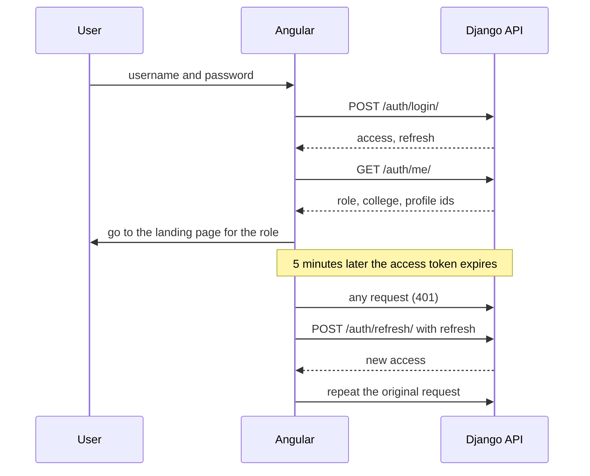
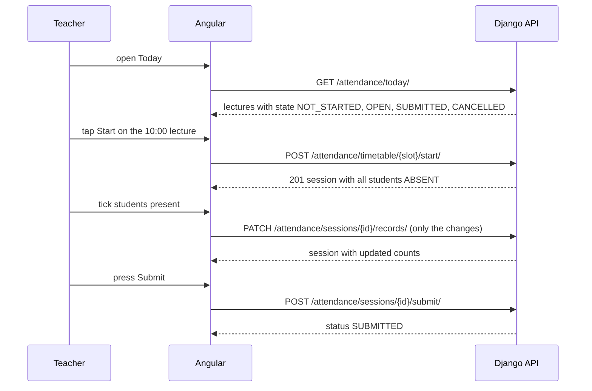
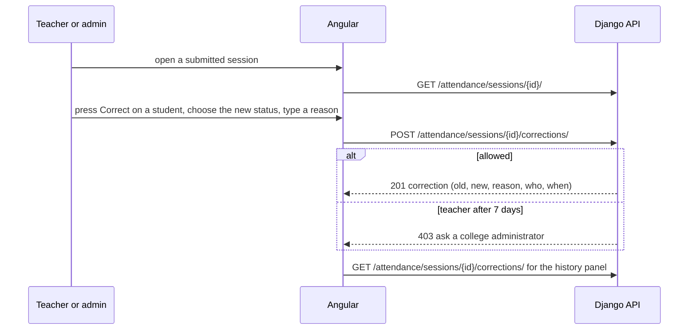

# Frontend Guide

How the Angular frontend talks to the Django API: conventions, roles, flows and known gaps.
The page-by-page list (which screen calls which endpoint) is in [FRONTEND_PAGES.md](FRONTEND_PAGES.md). The database design is in [DATABASE_SCHEMA.md](DATABASE_SCHEMA.md).

---

## 1. Quick facts

| Item | Value |
|---|---|
| Dev base URL | `http://127.0.0.1:8000` |
| API prefix | `/api/v1/` (all endpoints below are relative to the base URL) |
| Interactive docs | `/docs/` (Swagger UI, can send real requests) and `/redoc/` (read-only) |
| OpenAPI schema | `/api/schema/` live, or the snapshot `docs/openapi.yaml` |
| Regenerate the snapshot | from `backend/`: `python manage.py spectacular --validate --fail-on-warn --file ../docs/openapi.yaml` |
| Authentication | JWT, `Authorization: Bearer <access token>` |
| CORS | Allowed for `http://localhost:4200` and `http://127.0.0.1:4200`. Other origins: set `CORS_ALLOWED_ORIGINS` (comma separated) in the backend `.env` |
| Body format | JSON (`Content-Type: application/json`) |
| Time zone | `Asia/Kolkata`. Timestamps carry the offset, for example `2026-10-28T21:28:53+05:30` |
| Endpoints | 80 operations, listed in section 7 |

---

## 2. Authentication

### 2.1 Login and token lifetimes

```http
POST /api/v1/auth/login/
{"username": "teacher_001", "password": "..."}

200 OK
{"access": "<jwt>", "refresh": "<jwt>"}
```

| Token | Lifetime | Use |
|---|---|---|
| `access` | **5 minutes** | Sent with every API call |
| `refresh` | **1 day** | Only sent to `POST /api/v1/auth/refresh/` to get a new access token |

```http
POST /api/v1/auth/refresh/
{"refresh": "<jwt>"}

200 OK
{"access": "<new jwt>"}
```

Refresh tokens are **not rotated**: the same refresh token keeps working until it expires after one day, then the user must log in again.

### 2.2 After login: who is this user?

Call `GET /api/v1/auth/me/` once and keep the result in app state. It decides the menus and the landing page.

```json
{
  "public_id": "5d3e...",
  "username": "teacher_001",
  "first_name": "Amit",
  "last_name": "Patil",
  "email": "",
  "role": "TEACHER",
  "is_super_admin": false,
  "college": {"id": 1, "public_id": "...", "name": "SDSM College", "code": "225"},
  "student_profile_public_id": null,
  "teacher_profile_public_id": "..."
}
```

| Field | Notes |
|---|---|
| `role` | `SUPER_ADMIN`, `ADMIN`, `TEACHER`, `STUDENT`, or `null` if the user has no active role |
| `is_super_admin` | `true` for the `SUPER_ADMIN` role **and** for Django superusers (who may have no role). Check this, not only `role`, when deciding if the user sees all colleges |
| `college` | An admin's college, or the college from a student's or teacher's profile. `null` for a platform administrator |
| `student_profile_public_id` | Use it for `GET /api/v1/students/<id>/` (a student reading their own profile) |

Suggested landing pages: `TEACHER` goes to Today, `ADMIN` and `SUPER_ADMIN` to the admin dashboard, `STUDENT` to My Attendance.

### 2.3 What the HTTP interceptor must do

1. Add `Authorization: Bearer <access>` to every API request except login and refresh.
2. On a **401** from any other endpoint:
   - If the body has `"code": "user_deleted"`, the account was removed. Clear everything, go to login, show "Your account is no longer active".
   - If the body has `"code": "password_changed"`, the password was changed (on another device, or by an administrator), so every older token is dead. Do **not** try a refresh. Clear everything, go to login, show "Your password was changed. Please sign in again."
   - Otherwise try **one** refresh. If it succeeds, repeat the original request with the new access token. If refresh also returns 401, clear everything and go to login.
3. Run only **one refresh at a time**. When several requests fail together, queue them behind the single refresh.
4. A **403** means "logged in but not allowed". Do not log the user out. Show the message from `detail`.

### 2.4 Logout

The backend has no logout endpoint. Logging out means deleting both tokens and the cached `/auth/me/` data on the client. The refresh token stays valid on the server until it expires.

### 2.5 Storing tokens

Keep the access token in memory. Keep the refresh token in `sessionStorage` (cleared when the tab closes) or `localStorage` (survives restarts, but any injected script could read it). Pick based on how long you want users to stay signed in. If you use `localStorage`, never render untrusted HTML.

### 2.6 Account problems at login

| Situation | Response |
|---|---|
| Wrong username or password, **or** a deleted or inactive account | `401` `{"detail": "No active account found with the given credentials"}` (the same message on purpose) |
| Account deleted after login | The next request returns `401` with `"code": "user_deleted"`; refresh also fails |
| Password changed elsewhere | The next request returns `401` with `"code": "password_changed"`; refresh does not help (see 2.7) |

### 2.7 Changing the password

Every logged-in user can change their own password.

```http
POST /api/v1/auth/change-password/
{"old_password": "...", "new_password": "..."}

200 OK
{"access": "<new jwt>", "refresh": "<new jwt>"}
```

- **Replace both stored tokens with the pair in the response.** Changing the password invalidates every token issued before it, on all devices, so the old pair no longer works. The returned pair keeps the user signed in on this device.
- Other devices, and any administrator-triggered reset, get `401` with `"code": "password_changed"` on their next request and must sign in again (2.3).
- A user who is not logged in has no "forgot password" flow yet. An administrator resets the password in Django admin.

| 400 field | Cause |
|---|---|
| `old_password` | "The current password is incorrect." |
| `new_password` | Fails the password rules, or is the same as the current one |

Password rules (shown as a list of messages under `new_password`): at least 8 characters, not too common (such as `password123`), not entirely numeric, not too similar to the username or name, and **no space at the start or end** (the login form trims spaces, so such a password could never be typed back). Spaces inside a password are fine. The same rules apply when an administrator creates a student or teacher.

Show the rules next to the form, and a "show password" toggle. Do not trim what the user types before sending it; let the server report a leading or trailing space.

---

## 3. Conventions

### 3.1 Status codes

| Code | Meaning | What the UI should do |
|---|---|---|
| 200, 201, 204 | Success (201 for created, 204 for a delete) | |
| 400 | Validation error or a rule was broken | Show the messages next to the form fields, see 3.2 |
| 401 | Not logged in or token expired | The interceptor flow in 2.3 |
| 403 | Logged in but not allowed (wrong role, or a time limit such as the 7-day correction window) | Show `detail` in a message box |
| 404 | Not found **or** belongs to another college or another teacher. The backend never reveals which | "Not found" page |
| 405 | Method not allowed (for example `DELETE` on a timetable slot) | Should not happen if the UI follows this guide |
| 409 | Conflict: the item is in use and cannot be deleted (only assignment delete) | Show `detail` |

### 3.2 Error body shapes

```jsonc
// 400 - a field error. Keys are the request field names, values are lists of messages.
{"roll_number": ["This roll number is already used in this college and academic year."]}

// 400 - a rule that is not about one field
{"non_field_errors": ["This teacher already has a lecture at this time on this day."]}

// 400 - a nested list (for example marking attendance): the whole request failed
{"records": ["These records do not belong to this session: 2a566e74-..."]}

// 401 / 403 / 404 - a single message
{"detail": "Teachers can correct attendance only within 7 days of the session date. Ask a college administrator to make this correction."}
```

Write one reusable function that takes a 400 body and returns `{ fieldName: message }` plus a list of general messages. Show `non_field_errors` at the top of the form. If a key is not one of your form's fields, show it as a general message so no error is lost.

### 3.3 Lists and pagination

Every list endpoint returns:

```json
{"count": 25, "next": "http://.../?page=2", "previous": null, "results": [ ... ]}
```

- 20 items per page. Use `?page=2` for later pages.
- `?page_size=100` returns up to 100 (the maximum). Use it for dropdowns.
- **Exceptions that return plain objects, not pages:** `GET /attendance/today/` and `GET /attendance/my/`.
- Filters are query parameters, for example `?status=SUBMITTED&date__gte=2026-10-01`. The available filters are listed per endpoint in section 7.

### 3.4 Identifiers

| Where | Which id |
|---|---|
| In a URL path (`/students/<id>/`) | the `public_id` (UUID string) |
| In a request body that points to another record (`"program": 3`) | the integer `id` |
| In a query filter (`?academic_year=2`) | the integer `id` |

Every list item has both. Dropdowns should display a name and send the integer `id`.

### 3.5 Dates, times and numbers

| Kind | Format | Example |
|---|---|---|
| Date | `YYYY-MM-DD` | `2026-10-28` |
| Time of day | `HH:MM` or `HH:MM:SS` when sending; responses use `HH:MM:SS` | `10:00:00` |
| Timestamp | ISO 8601 with offset | `2026-10-28T21:37:01.953260+05:30` |
| Day of week | integer 1 to 7, **1 = Monday, 7 = Sunday** (JavaScript's `getDay()` is 0 to 6 with Sunday as 0, so convert) | `3` is Wednesday |
| Percentage | number with one decimal, or `null` when there is nothing to divide | `66.7` |

Dates such as a lecture date are plain calendar days with no zone. Do not convert them with `new Date()`; treat them as strings to avoid off-by-one-day errors.

### 3.6 Enumerated values

| Field | Allowed values |
|---|---|
| Role | `SUPER_ADMIN`, `ADMIN`, `TEACHER`, `STUDENT` |
| Session `status` | `OPEN`, `SUBMITTED`, `CANCELLED` |
| Lecture `state` (today list) | `NOT_STARTED`, `OPEN`, `SUBMITTED`, `CANCELLED` |
| Record `status` | `PRESENT`, `ABSENT` |
| Record `method` | `MANUAL`, `FACE_RECOGNITION` (only `MANUAL` exists today) |
| Enrollment `status` | `ACTIVE`, `COMPLETED`, `WITHDRAWN`, `SUSPENDED` |
| Subject `subject_type` | `THEORY`, `PRACTICAL` |
| Timetable `day_of_week` | `1` Monday ... `7` Sunday (responses also have `day_name`) |

---

## 4. Roles and what each can do

`SUPER_ADMIN` and Django superusers see every college. `ADMIN` is limited to the college in `/auth/me/`. Records of another college always return 404.

| Feature | SUPER_ADMIN | ADMIN | TEACHER | STUDENT |
|---|---|---|---|---|
| Read academics lists (colleges, departments, programs, semesters, subjects, academic years, subject offerings) | all colleges | own college | own college | own college |
| Create or edit colleges and academic years | yes | **no** (platform-wide data) | no | no |
| Create or edit departments, programs, semesters, subjects and subject offerings | yes (any college) | yes (own college only) | no | no |
| Students: list, create, edit | all colleges | own college | no (403) | no. Can **read only their own** profile |
| Enrollments: list, create, edit | all colleges | own college | no | no |
| Teachers: list, create, edit | all colleges | own college | no | no |
| Teacher subject assignments: list, create, edit, **delete** | all colleges | own college | no | no |
| Timetable: read | all | own college | **own slots only** | no |
| Timetable: create, edit, deactivate | yes | own college | no | no |
| Today's lectures | all | own college | own | no |
| Open a session by hand, start from a slot, mark, submit, cancel | yes | own college | own sessions | no |
| Corrections | any time | any time, own college | own sessions, **within 7 days** of the session date | no |
| My attendance (summary and lecture list) | no | no | no | **yes, own only** |
| My subject assignments (`/attendance/my-assignments/`, for the extra-lecture dropdown) | no | no | **own only** | no |
| Change own password | yes | yes | yes | yes |
| Correct a **student's** first or last name | yes (own college) | yes (own college) | no | **no, not even their own** |
| Change **own** first or last name | no | no | **yes, in their own profile** (`/teachers/me/`) | no |
| Change an email address or a username | **nobody** (set once when the account is created) | | | |
| Search and filter the student, teacher, enrollment and assignment lists | yes | yes (own college) | no | no |

Creating a student or teacher needs the `college` id in the body. For an `ADMIN` it must equal their own college (take it from `/auth/me/` and send it as a hidden field). A `SUPER_ADMIN` chooses it from `GET /academics/colleges/`.

---

## 5. Key flows

### 5.1 Login, refresh, first screen



### 5.2 A teacher's day: take attendance from the timetable



Behaviour worth knowing:
- **Start is safe to repeat.** A second tap, or a second device, gets `200` with the same session instead of an error.
- **Marking sends only changes.** Sending a record with the status it already has is harmless. "Mark all present" can simply send every record as `PRESENT`.
- **Save strategy.** Either send a PATCH on each tick (with a short debounce) or keep ticks in the browser and send once on "Save". After **Submit** the session is locked.
- **Extra lectures** (not in the timetable) use `POST /attendance/sessions/` with `teacher_assignment`, `date`, `start_time`, `end_time`. The teacher picks the subject from `GET /attendance/my-assignments/?is_active=true`, and the item's `id` is the `teacher_assignment`.
- **Forgotten lectures.** `GET /attendance/today/?date=2026-10-27` shows an earlier day, and starting a slot with `{"date": "2026-10-27"}` works for any past date that matches the slot's weekday.
- **A lecture that did not happen:** `POST /attendance/sessions/{id}/cancel/` with a reason, while it is still `OPEN`.

### 5.3 Fixing a mistake after submitting



### 5.4 Admin: onboarding a new student for the year

1. `GET /academics/programs/` and `GET /academics/academic-years/` fill the dropdowns.
2. `POST /students/` creates the login and profile. **Keep `id` from the response.**
3. `POST /students/enrollments/` with `student` (that `id`), `academic_year`, `program`, `year_of_study` (1 to the program's `duration_years`) and `roll_number`.
4. The student can now log in and will appear in the matching sessions.

Year of study decides which subjects a student takes: Semester 1-2 subjects belong to year 1, Semester 3-4 to year 2, Semester 5-6 to year 3.

### 5.5 Admin: setting up a semester

1. `POST /teachers/` for any new teacher.
2. `POST /teachers/subject-assignments/` with `teacher` (id) and `subject_offering` (id from `GET /academics/subject-offerings/?academic_year=...`).
3. `POST /attendance/timetable/` for each weekly lecture, with `teacher_assignment` (the assignment's id), `day_of_week`, times, `room`, `valid_from` and `valid_to` (both inside the academic year).
4. Teachers now see these lectures in Today on the matching weekdays.

---

## 6. Known gaps in the backend

Found while mapping every page to its API calls. Each has a workaround so the frontend can start now. Priority means "should the backend change before or during frontend work".

| # | Gap | Effect on the frontend | Workaround today | Suggested backend fix | Priority |
|---|---|---|---|---|---|
| G1 | ✅ **Fixed 2026-10-28.** A teacher could not list their own subject assignments | | | `GET /attendance/my-assignments/` (section 7.5) | done |
| G2 | ✅ **Fixed 2026-10-28.** No search or filters on students, teachers, enrollments and assignments | | | `search` and filters on all four lists (sections 7.3 and 7.4) | done |
| G3 | ✅ **Fixed 2026-10-28.** No change-password endpoint | | | `POST /auth/change-password/` (section 2.7). **Forgot-password** (a user who cannot log in) is still not built; an administrator resets it in Django admin | done, reset flow open |
| G4 | ✅ **Fixed 2026-10-28** (by decision: **email and username stay read-only**). Names could not be edited | | | Administrators correct a student's or teacher's name; a teacher edits their own name at `/teachers/me/`; a student cannot change their name (section 7.3 and 7.4) | done |
| G5 | ✅ **Fixed 2026-10-28.** No write API for academics | | | Create, read-one and edit for colleges, departments, programs, semesters, subjects, academic years and subject offerings, plus `search` on every list (section 7.2). **Still Django admin only:** creating admin users and roles | done for academics |
| G6 | A student **cannot see which academic years they were enrolled in** | The year switcher on My Attendance cannot know the valid years | Offer the years from `/academics/academic-years/` and treat a `404` as "not enrolled that year" | Add the enrolled years to `GET /attendance/my/` | Medium |
| G7 | **Session list filters are limited** to `date`, `date__gte`, `date__lte`, `status`, `teacher_assignment`, `teacher_assignment__subject_offering` | An admin cannot filter sessions by teacher name, subject name or academic year | Filter by the ids above and sort in the browser | `teacher`, `academic_year`, `subject` filters | Medium |
| G8 | Students and teachers **cannot be deleted or deactivated through the API** (a teacher has `is_active`; a student has none) | No "remove user" button | Django admin sets `is_deleted`. For students use enrollment `status` (`WITHDRAWN`, `SUSPENDED`) | A soft-delete endpoint | Low |
| G9 | **No dashboard statistics** | A dashboard cannot show totals or today's attendance rate | Read `count` from list responses with `?page_size=1`. Count today's OPEN, SUBMITTED lectures from `/attendance/today/` | Part of the reports phase | Low |
| G10 | **No reports or exports** (defaulter list, class report, CSV or Excel) | No report pages | The 75 % warning on My Attendance is a frontend constant | Planned reports phase | Planned |
| G11 | **No student timetable** | Students cannot see their weekly schedule | none | `GET /attendance/my/timetable/` | Low |
| G12 | **No holiday calendar** | A slot shows `NOT_STARTED` all day on a holiday | Teacher ignores it | Holiday table, planned | Low |
| G13 | **Face recognition attendance** does not exist yet | Marking is manual only (`method` is always `MANUAL`) | Manual marking | Planned face service | Planned |

**Status:** G1 to G5 are fixed. G1 to G3 were the ones that blocked normal use. Everything left (G6 onwards) has a workaround and can follow the first working screens. If a user cannot log in at all, an administrator still resets the password in Django admin (a self-service reset needs email and is not built).

---

## 7. Endpoint reference (all 80 operations)

**Who** codes: `Admin` = `ADMIN` and `SUPER_ADMIN` (own college, or all for super admin). `Teacher` = a teacher on their **own** records. `Student` = a student on their own records. `Any` = any logged-in user. Anything else is rejected with 403, and records outside the user's reach with 404.
Every list endpoint is paginated (3.3) unless stated. Prefer `PATCH` over `PUT`.

### 7.1 Authentication

| Method | Path | Who | Purpose |
|---|---|---|---|
| POST | `/auth/login/` | public | `{username, password}` returns `{access, refresh}` |
| POST | `/auth/refresh/` | public | `{refresh}` returns `{access}` |
| GET | `/auth/me/` | Any | The logged-in user: role, college, profile ids |
| POST | `/auth/change-password/` | Any | `{old_password, new_password}` returns a new `{access, refresh}` pair. Older tokens stop working (2.7) |

### 7.2 Academics (read and write)

Seven resources, each with the same four operations:

| Operation | Path | Who |
|---|---|---|
| List (paginated, with filters and `search`) | `GET /academics/<resource>/` | **Any** logged-in user, limited to their college (super admin sees all) |
| Create | `POST /academics/<resource>/` | Admins (see the table below). Returns `201` |
| Read one | `GET /academics/<resource>/{public_id}/` | **Any** logged-in user, limited to their college |
| Edit | `PATCH` or `PUT /academics/<resource>/{public_id}/` | Admins (see the table below) |

There is **no delete** (`405`). To retire a record, set `is_active` to `false`: enrollments, subjects and attendance point at these rows. Responses include the integer `id` that other requests need.

| Resource (`<resource>`) | Who can create and edit | Create body | List filters | `search` matches |
|---|---|---|---|---|
| `colleges` | **Super admin only** | `name`, `code` (unique); optional `address`, `email`, `phone`, `is_active` | `is_active` | name, code |
| `departments` | College admin (own college), super admin | `college`, `name`, `code`; optional `description`, `is_active` | `college`, `is_active` | name, code |
| `programs` | College admin, super admin | `department`, `name`, `code`, `duration_years` (1 to 10); optional `description` | `department`, `is_active` | name, code |
| `semesters` | College admin, super admin | `program`, `semester_number`; optional `name` (default "Semester N") | `program`, `is_active` | name |
| `subjects` | College admin, super admin | `semester`, `name`, `code`, `subject_type` (`THEORY`, `PRACTICAL`); optional `credits` | `semester`, `semester__program`, `subject_type`, `is_active` | name, code |
| `academic-years` | **Super admin only** (shared by every college) | `name`, `start_date`, `end_date`; optional `is_active` | `is_active` | name |
| `subject-offerings` | College admin, super admin | `academic_year`, `subject` | `academic_year`, `subject__semester`, `subject__semester__program`, `is_active` | subject name, subject code |

`programs` responses include `duration_years` (the upper limit for an enrollment's year of study). `subject-offerings` responses include `subject_name`, `subject_code`, `subject_type`, `semester_number`, `program_name` and `academic_year_name` for dropdown labels.

**Rules the server enforces** (a violation is a `400` with the message under the field):

- **College admins stay in their own college.** A parent from another college (a department, program, semester or subject) is rejected as if it did not exist.
- **Parents must be active.** Nothing can be added under an inactive college, department, program, semester or subject.
- **Duplicates.** A code or name must be unique inside its parent: a department's `code` and `name` inside the college, a program's inside the department, a semester number inside the program, a subject `code` inside the semester, a subject once per academic year, a college `code` and an academic-year `name` overall. The same code in another college is fine.
- **Parent links cannot change after creation:** a department's `college`, a program's `department`, a semester's `program` and `semester_number`, a subject's `semester`, an offering's `academic_year` and `subject`. Sending the unchanged value is harmless. To "move" something, create a new record and deactivate the old one.
- **Semester number** must be between 1 and `duration_years × 2` of its program (two semesters per year).
- **Shortening a program** (`duration_years`) is rejected if students are already enrolled in a later year, or a later semester exists.
- **Academic year name** must look like `2026-2027`: four digits, a normal hyphen (not an en dash), and the following year. The end date must be after the start date, and years **cannot overlap** (a year may start the day after another ends).
- **Only one academic year is active.** Activating a year automatically deactivates the others. Setting all of them to inactive is allowed.
- **Moving an academic year's dates** is rejected if attendance sessions or timetable slots of that year would fall outside the new dates.

### 7.3 Students

| Method | Path | Who | Purpose | Body or filters |
|---|---|---|---|---|
| GET | `/students/` | Admin | List students | `search` (name, username, phone, roll number of any enrollment); `college`, `academic_year`, `program`, `year_of_study`, `enrollment_status`. The four enrollment filters are matched against **one** enrollment together |
| POST | `/students/` | Admin | Create login and profile | `username`, `password`, `first_name`, `last_name`, `college`; optional `email`, `date_of_birth`, `phone`, `address`. Returns `201` with the profile including `id` |
| GET | `/students/{public_id}/` | Admin, or the student for themselves | One profile | |
| PATCH / PUT | `/students/{public_id}/` | Admin | Edit | `first_name`, `last_name` (each 1 to 150 characters, not blank), `date_of_birth`, `phone`, `address`. **`email` and `username` are read-only**: sending them is ignored. A student gets `403` on every write, so they cannot change their own name. Responses show `email` |
| GET | `/students/enrollments/` | Admin | List enrollments | `search` (student name or username, roll number); `student` (id), `college`, `academic_year`, `program`, `year_of_study`, `status` |
| POST | `/students/enrollments/` | Admin | Enrol a student for a year | `student` (id), `academic_year` (id), `program` (id), `year_of_study`, `roll_number`; optional `status` |
| GET | `/students/enrollments/{public_id}/` | Admin | One enrollment | |
| PATCH / PUT | `/students/enrollments/{public_id}/` | Admin | Edit (for example `status`, `roll_number`) | |

### 7.4 Teachers

| Method | Path | Who | Purpose | Body or filters |
|---|---|---|---|---|
| GET | `/teachers/` | Admin | List teachers | `search` (name, username, employee id, phone); `college`, `is_active` |
| POST | `/teachers/` | Admin | Create login and profile | `username`, `password`, `first_name`, `last_name`, `college`, `employee_id`; optional `email`, `phone`, `date_of_joining`, `is_active`. Returns `201` with `id` |
| GET | `/teachers/{public_id}/` | Admin | One profile | |
| PATCH / PUT | `/teachers/{public_id}/` | Admin | Edit | `first_name`, `last_name`, `employee_id`, `phone`, `date_of_joining`, `is_active`. `email` and `username` are read-only |
| GET | `/teachers/me/` | **Teacher only** | The logged-in teacher's own profile (including `email`, `employee_id`, `college`) | |
| PATCH | `/teachers/me/` | **Teacher only** | A teacher changes **their own name** | Only `first_name` and `last_name` (1 to 150 characters, not blank). Every other field in the body, including `email`, `employee_id`, `phone` and `is_active`, is ignored. `PUT` and `DELETE` return 405 |
| GET | `/teachers/subject-assignments/` | Admin | List who teaches what | `search` (teacher name, username or employee id; subject name or code); `teacher` (id), `subject_offering` (id), `academic_year`, `program` |
| POST | `/teachers/subject-assignments/` | Admin | Assign a teacher | `teacher` (id), `subject_offering` (id) |
| GET | `/teachers/subject-assignments/{public_id}/` | Admin | One assignment | |
| PATCH / PUT | `/teachers/subject-assignments/{public_id}/` | Admin | Edit | |
| DELETE | `/teachers/subject-assignments/{public_id}/` | Admin | Remove an assignment | `204`. Returns `409` with a message while the assignment has timetable slots or sessions (deactivate the slots instead) |

### 7.5 Timetable and today

| Method | Path | Who | Purpose | Body or filters |
|---|---|---|---|---|
| GET | `/attendance/timetable/` | Admin, Teacher | List slots (teacher: own only) | `day_of_week`, `is_active`, `teacher_assignment`, `teacher_assignment__subject_offering`, `teacher_assignment__teacher` |
| POST | `/attendance/timetable/` | Admin | Create a weekly slot | `teacher_assignment`, `day_of_week` (1 to 7), `start_time`, `end_time`, `valid_from`, `valid_to`; optional `room`, `is_active` |
| GET | `/attendance/timetable/{public_id}/` | Admin, Teacher | One slot | |
| PATCH / PUT | `/attendance/timetable/{public_id}/` | Admin | Edit. `teacher_assignment` cannot change. Set `is_active: false` instead of deleting | |
| POST | `/attendance/timetable/{public_id}/start/` | Admin, Teacher | Start attendance for the slot. `201` new, `200` already started | Optional `{"date": "YYYY-MM-DD"}`, default today |
| GET | `/attendance/today/` | Admin, Teacher | Lectures for a day (not paginated) | `date` (default today) |
| GET | `/attendance/my-assignments/` | **Teacher only** | The teacher's own subject assignments, for subject dropdowns. Each item has `id` (send it as `teacher_assignment`), `subject_name`, `subject_code`, `subject_type`, `semester_number`, `program_name`, `academic_year_name` and `is_active` (of the offering) | `academic_year` (id; default is the year that includes today), `is_active` (use `true` for the extra-lecture form) |

### 7.6 Sessions, marking and corrections

| Method | Path | Who | Purpose | Body or filters |
|---|---|---|---|---|
| GET | `/attendance/sessions/` | Admin, Teacher | List sessions (teacher: own only), newest first | `date`, `date__gte`, `date__lte`, `status`, `teacher_assignment`, `teacher_assignment__subject_offering` |
| POST | `/attendance/sessions/` | Admin, Teacher | Open an extra lecture by hand | `teacher_assignment`, `date`, `start_time`, `end_time`. Returns `201` with students |
| GET | `/attendance/sessions/{public_id}/` | Admin, Teacher | Session with its `records` | |
| PATCH | `/attendance/sessions/{public_id}/records/` | Admin, Teacher | Mark students while `OPEN` | `{"records": [{"public_id": "...", "status": "PRESENT"}]}`. Send only changes. All or nothing |
| POST | `/attendance/sessions/{public_id}/submit/` | Admin, Teacher | Lock the session | no body |
| POST | `/attendance/sessions/{public_id}/cancel/` | Admin, Teacher | Cancel an `OPEN` session | `{"reason": "..."}` (required, up to 500 characters) |
| GET | `/attendance/sessions/{public_id}/corrections/` | Admin, Teacher | Correction history, oldest first | |
| POST | `/attendance/sessions/{public_id}/corrections/` | Admin, Teacher | Correct a record of a `SUBMITTED` session | `{"record": "<record public_id>", "status": "PRESENT", "reason": "..."}`. Teacher: 403 after 7 days |

### 7.7 Student attendance

| Method | Path | Who | Purpose | Filters |
|---|---|---|---|---|
| GET | `/attendance/my/` | Student | Per-subject summary and overall percentage (not paginated) | `academic_year` |
| GET | `/attendance/my/records/` | Student | Lecture-by-lecture list, newest first | `academic_year`, `date`, `date__gte`, `date__lte`, `subject_offering`, `status` |

Only submitted sessions count for students. Without `academic_year`, the active academic year is used if the student is enrolled in it, otherwise their latest enrollment. A year the student was not enrolled in returns `404`; a non-numeric value returns `400`.

---

## 8. Angular implementation notes

### 8.1 Suggested structure

```text
src/app/
  core/            auth service, token storage, HTTP interceptor, route guards, current-user state
  shared/          error-message helper, pagination component, confirm dialog, status badges
  api/             optional generated client (see 8.2)
  features/
    auth/          login
    teacher/       today, attendance, sessions, timetable
    admin/         dashboard, students, enrollments, teachers, assignments, timetable, sessions
    student/       my attendance
```

Lazy-load each `features/*` area. Guard them with an `authGuard` (logged in) and a `roleGuard` that reads `data: { roles: ['TEACHER'] }` from the route and compares it with the role from `/auth/me/`. Redirect a signed-in user who opens a route for another role to their own landing page.

### 8.2 Typed API client (optional)

The backend publishes a full OpenAPI schema, so the TypeScript types and services can be generated instead of written by hand:

```powershell
npx @openapitools/openapi-generator-cli generate -i ../docs/openapi.yaml -g typescript-angular -o src/app/api
```

Regenerate it whenever the backend changes (section 1 shows how to refresh `docs/openapi.yaml`). If you prefer to write services by hand, the types in section 7 are enough.

### 8.3 Working with the API

| Topic | Advice |
|---|---|
| Environment | Keep `apiBaseUrl` in `environment.ts` (`http://127.0.0.1:8000/api/v1`). Never hard-code it in components |
| Loading and double submits | Disable a button while its request is running. Starting a lecture is safe to repeat, but submit, cancel and corrections should not be fired twice |
| Forms | Use reactive forms. Map the 400 body (3.2) to the matching controls with `setErrors({ server: message })` |
| Dropdowns | Fetch with `?page_size=100`. Show a readable label (`subject_name`, `program_name`, `student_name`) and bind the integer `id`. For a long list such as students, use a type-ahead: call the list with `?search=<what was typed>&page_size=20` after a short debounce, instead of loading everything |
| Search boxes | Pass the text as `?search=`. Several words must all match (`rahul sharma`). Combine with filters; changing a filter or the text should reset to `?page=1` |
| Marking screen | Keep the records in a local array sorted by `roll_number` (the API already sorts them). Show present and absent counts from the response after every save |
| Unsaved changes | If ticks are saved only on "Save", warn before leaving the page |
| Dates | Treat `date` values as strings (`YYYY-MM-DD`). Format with a pipe for display. Do not run them through `new Date()` and back |
| Weekly timetable grid | One request: `GET /attendance/timetable/?is_active=true&page_size=100`. Group by `day_of_week` (1 to 7), sort by `start_time`. For an admin with more than 100 slots, filter by teacher or subject offering instead |
| Student percentages | Show `percentage` and flag subjects under 75 %. The 75 % figure is a UI constant for now; the backend has no defaulter rule yet |
| Roles in templates | Hide menu items by role for a better experience, but never rely on it for security. The API enforces every rule |

### 8.4 Local setup for development

1. Start the backend: from `backend/` run `.\.venv\Scripts\Activate.ps1` and `python manage.py runserver`.
2. Run the Angular dev server on `http://localhost:4200` (already allowed by CORS).
3. Test users already exist in the local database: `admin` (super admin), `college_admin` (admin), `teacher_001`, `teacher_002`, and students such as `student_test_002`. Passwords are never stored in readable form. Set one with `python manage.py changepassword <username>`.
4. Use `http://127.0.0.1:8000/docs/` to try any call before coding it: log in, click **Authorize**, and paste the access token.
5. Automated backend tests: `python manage.py test apps` (285 tests at the time of writing).
6. After the 2026-10-28 backend update, tokens issued earlier are rejected once. Log in again in `/docs/` and in the app.

### 8.5 Suggested build order

1. **App shell and login:** interceptor, refresh, `/auth/me/`, guards, role-based landing page.
2. **Student: My Attendance.** The smallest area and it exercises tokens, filters and pagination.
3. **Teacher: Today, Take Attendance, Sessions.** The main daily workflow.
4. **Admin: students, teachers, enrollments, assignments.** Mostly forms and lists.
5. **Admin: timetable and sessions.**
6. Add the account screen (change password) to the app shell as soon as login works.

